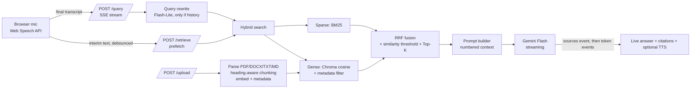

# Real-Time IT Troubleshooting Voice Assistant

Voice-enabled RAG assistant for laptop, network, software, VPN and server issues. Answers are grounded in uploaded manuals, streamed token-by-token, and cited (`[1]`, `[2]`).

**Stack:** FastAPI · ChromaDB (cosine HNSW) · sentence-transformers `all-MiniLM-L6-v2` · BM25 (rank-bm25) · Google Gemini (2.5 Flash for answers, 2.5 Flash-Lite for query rewriting) · browser Web Speech API for voice.

## Architecture



## Quick start

```bash
python -m venv .venv && source .venv/bin/activate
pip install -r requirements.txt
export GEMINI_API_KEY=your-key        # or copy .env.example
uvicorn app.main:app --reload
# load sample docs
for f in sample_docs/*; do curl -F "file=@$f" localhost:8000/upload; echo; done
# open http://localhost:8000  (Chrome/Edge for voice)
```

Swap the LLM by editing `app/llm.py` (the only file that touches the provider; e.g. Ollama).

## API

| Endpoint | Purpose |
|---|---|
| `GET /health` | status, chunk count, models |
| `POST /upload` | multipart: `file` (pdf/docx/txt/md), optional `category`, `topic`, `district`. Re-uploading a filename replaces it. Category is auto-inferred by keyword if omitted. |
| `POST /retrieve` | JSON `{query, top_k=5, threshold=0.30, hybrid=true, filters:{category,source,topic,district}}` → ranked chunks with `similarity`, `fused_score`, metadata, `retrieval_ms` |
| `POST /query` | same fields + `session_id`, `rewrite`. Returns **SSE**: `sources` (rewritten query + citations) → many `token` → `done` (timings). |
| `DELETE /session/{id}` | clear conversation memory |

Interactive docs: `http://localhost:8000/docs` (OpenAPI, auto-generated).

```bash
curl -N localhost:8000/query -H 'Content-Type: application/json' \
  -d '{"query":"My laptop connects to Wi-Fi but the internet is not working","filters":{"category":"network"}}'
```

## Metadata
`category` (network/vpn/server/laptop/software/general), `topic`, `source` (filename), `section` (heading), `district` (site/region/business unit; defaults `global`). All are filterable at query time (pre-filter in Chroma, same filter applied to BM25).

## Bonus features implemented
Hybrid search (dense + BM25 via RRF) · query rewriting for follow-ups · per-session conversation memory · multi-document retrieval · inline citations with source/section.

## Project layout
`app/ingest.py` parsing+chunking · `app/store.py` embeddings, vector DB, hybrid search, caches · `app/llm.py` prompts, rewrite, streaming · `app/main.py` API · `static/index.html` voice UI · `sample_docs/` · `DESIGN_NOTE.md`

## Known limits / next steps
In-memory sessions and BM25 index (move to Redis / Chroma server for multi-worker) · no OCR for scanned PDFs · no reranker yet (cross-encoder would improve precision at ~30-60 ms) · no automated eval set (add 30-50 question→expected-source pairs and track recall@K).
